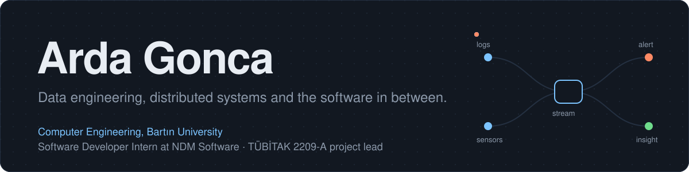
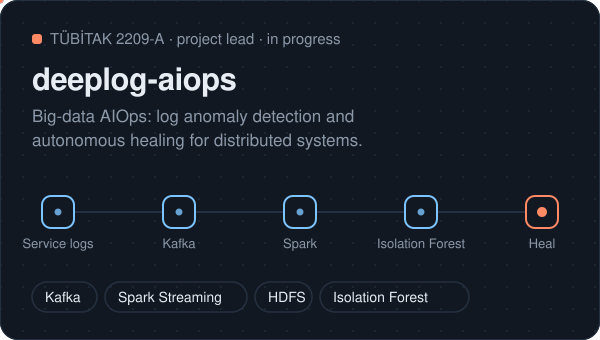
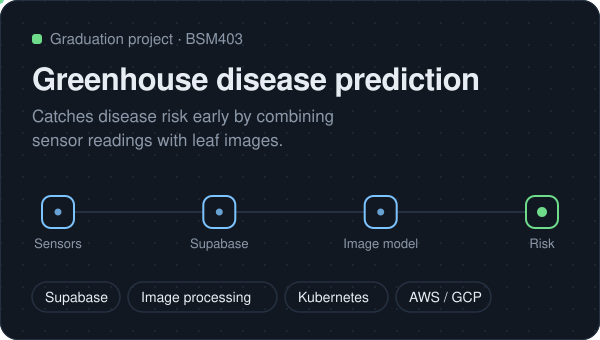
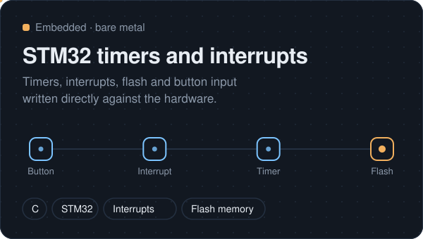
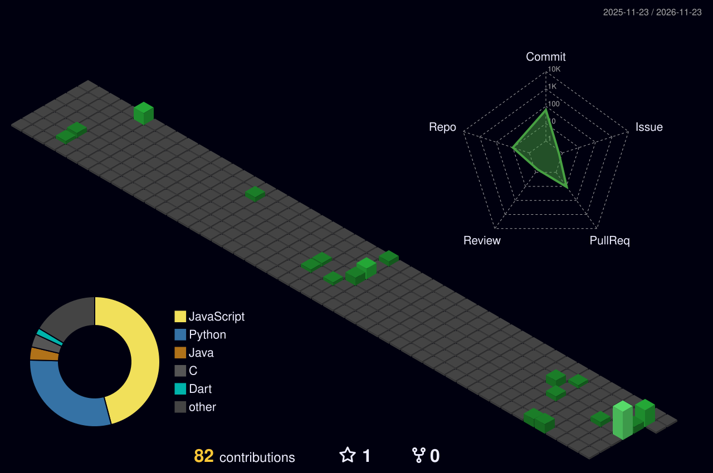

  

<h3></h3>

I'm a computer engineering student at Bartın University, and this is where I keep the things I build. Most of them sit somewhere between raw data and a decision: streaming pipelines, distributed systems that watch themselves, and models that turn sensor readings into warnings. Every so often something closer to the metal, or a game for friends.

Click any project to open its repository.

<h3></h3>

<table>
  <tr>
    <td width="50%"></td>
    <td width="50%"></td>
  </tr>
  <tr>
    <td width="50%"></td>
    <td width="50%"></td>
  </tr>
</table>

<h3></h3>

| Project | What it does | Built with |
|---|---|---|
| [restoran-stok-takip](https://github.com/ardagonca/restoran-stok-takip) | Stock tracking for restaurant kitchens | JavaScript |
| [expense-tracker](https://github.com/ardagonca/expense-tracker) | Personal expense tracking | Java |
| Warehouse delivery robot | Autonomous delivery along a taped track, built as a team | Raspberry Pi Zero 2 W, Gazebo |
| LAN game platform | Lobby and games for friends on the local network, multiplayer 3D shooter in progress | Web, real-time |

<h3></h3>

  

<h3></h3>

<!-- activity:start -->
| Repository | What it is | Language | Last push |
|---|---|---|---|
| [deeplog-aiops](https://github.com/ardagonca/deeplog-aiops) | Büyük veri tabanlı AIOps: Kafka + HDFS + Spark ile log anomali tespiti (DeepLog) ve otonom iyileştirme. TÜBİTAK 2209-A. | Python | today |
| [smart-greenhouse-infra](https://github.com/ardagonca/smart-greenhouse-infra) |  | JavaScript | today |
| [expense-tracker](https://github.com/ardagonca/expense-tracker) |  | Java | 1 mo ago |
| [restoran-stok-takip](https://github.com/ardagonca/restoran-stok-takip) |  | JavaScript | 5 mo ago |
| [STM32-Timer_Interrupt_Flash_Button](https://github.com/ardagonca/STM32-Timer_Interrupt_Flash_Button) |  | C | 6 mo ago |
<!-- activity:end -->

This table updates itself every few hours from my latest pushes.

  

