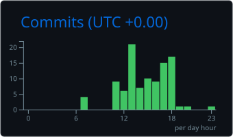
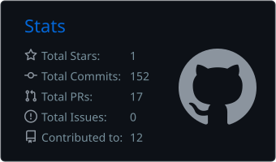

  

  

  Computer Engineering @ Bartın University &nbsp;·&nbsp; Software Developer Intern @ NDM Software &nbsp;·&nbsp; TÜBİTAK 2209-A Researcher

 

  

<h3></h3>

I'm a final-year computer engineering student who likes turning raw data into something people can actually act on. Most days I'm writing code for a remote team at NDM Software, most nights I'm on my TÜBİTAK-supported research, and whatever is left goes into side projects.

Right now that means:

- **Capstone** — a greenhouse disease prediction system: sensor + image data, Supabase, image processing, deployed on Kubernetes
- **Research** — early-warning of disease risk from greenhouse micro-climate data
- **Work** — shipping features with a remote dev team at NDM Software
- **Side quests** — a LAN game platform for friends, with a multiplayer 3D FPS in progress

Open to data engineering, BI and software internships.

<h3></h3>

  

<h3></h3>

| | | |
|---|---|---|
| **[smart-greenhouse-infra](https://github.com/ardagonca/smart-greenhouse-infra)** | Infrastructure for greenhouse disease-risk prediction | Kubernetes · Supabase · AWS/GCP |
| **[E-CommerceSpringReact](https://github.com/ardagonca/E-CommerceSpringReact)** | Full-stack e-commerce platform | Spring Boot · React · TypeScript |
| **[restoran-stok-takip](https://github.com/ardagonca/restoran-stok-takip)** | Restaurant inventory tracking | JavaScript |
| **[STM32-Timer_Interrupt_Flash_Button](https://github.com/ardagonca/STM32-Timer_Interrupt_Flash_Button)** | Timer interrupts, flash and button handling on bare metal | C · STM32 |

<h3></h3>

  
  

  

  <picture>
    <source media="(prefers-color-scheme: dark)" srcset="https://raw.githubusercontent.com/ardagonca/ardagonca/output/github-contribution-grid-snake-dark.svg" />
    <source media="(prefers-color-scheme: light)" srcset="https://raw.githubusercontent.com/ardagonca/ardagonca/output/github-contribution-grid-snake.svg" />
    
  </picture>

  if it compiles at 3 AM, it ships at 9.

