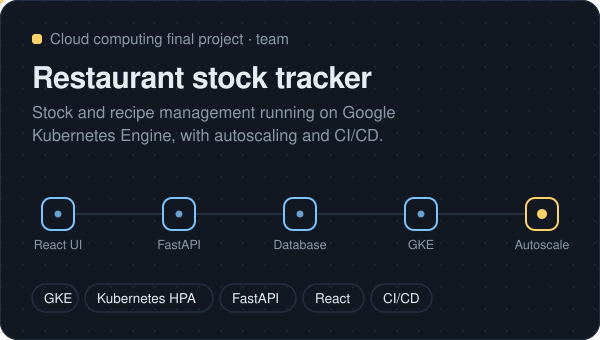
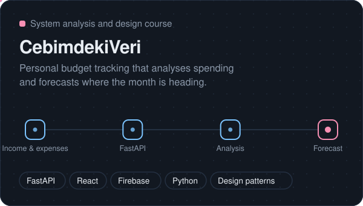
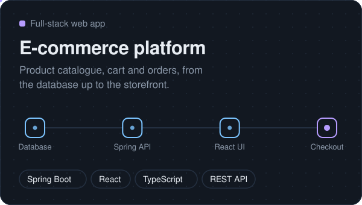
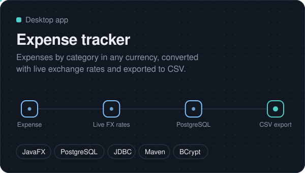

  

<h3></h3>

I'm a computer engineering student at Bartın University, and this is where I keep the things I build. Most of them sit somewhere between raw data and a decision: streaming pipelines, distributed systems that watch themselves, and models that turn sensor readings into warnings. Every so often something closer to the metal.

Click any project to open its repository.

<h3></h3>

<table>
  <tr>
    <td width="50%"></td>
    <td width="50%"></td>
  </tr>
  <tr>
    <td width="50%"></td>
    <td width="50%"></td>
  </tr>
  <tr>
    <td width="50%"></td>
    <td width="50%"></td>
  </tr>
</table>

<h3></h3>

| Project | What it does | Built with |
|---|---|---|
| [STM32-Timer_Interrupt_Flash_Button](https://github.com/ardagonca/STM32-Timer_Interrupt_Flash_Button) | Timer interrupts, flash storage and button handling on an STM32F103 | C, STM32CubeIDE, HAL |
| [Learning-Data](https://github.com/ardagonca/Learning-Data) | Data analysis and ML notebooks: CS2 player stats, bank marketing cleanup, sales and shopping trends | Python, pandas, scikit-learn, SQL |
| [Chat-App](https://github.com/ardagonca/Chat-App) | Real-time chat app | React, Firebase |
| [EmployeeManagement](https://github.com/ardagonca/EmployeeManagement) | Staff management desktop app with login, records and charts | JavaFX, SQL database |
| [CargoManagementSystem](https://github.com/ardagonca/CargoManagementSystem) | Cargo company panel for branches, staff, positions and orders | PHP, MySQL |
| [Pomodoro](https://github.com/ardagonca/Pomodoro) | Pomodoro focus timer | JavaFX, Scene Builder |

<h3></h3>

  

<h3></h3>

<!-- activity:start -->
| Repository | What it is | Language | Last push |
|---|---|---|---|
| [deeplog-aiops](https://github.com/ardagonca/deeplog-aiops) | Büyük veri tabanlı AIOps: Kafka + HDFS + Spark ile log anomali tespiti (DeepLog) ve otonom iyileştirme. TÜBİTAK 2209-A. | Python | yesterday |
| [smart-greenhouse-infra](https://github.com/ardagonca/smart-greenhouse-infra) | Greenhouse monitoring and disease-risk forecasting: MQTT sensor ingest, FastAPI, PyTorch and scikit-learn models, React + Electron dashboard. | JavaScript | yesterday |
| [expense-tracker](https://github.com/ardagonca/expense-tracker) | Expense tracker in JavaFX and PostgreSQL with categories, live currency conversion and CSV export. | Java | 1 mo ago |
| [restoran-stok-takip](https://github.com/ardagonca/restoran-stok-takip) | Restaurant stock and recipe tracker on Google Kubernetes Engine: React, FastAPI, HPA autoscaling, persistent storage and CI/CD. | JavaScript | 5 mo ago |
| [STM32-Timer_Interrupt_Flash_Button](https://github.com/ardagonca/STM32-Timer_Interrupt_Flash_Button) | Timer interrupts, flash storage and button handling on an STM32F103 with STM32CubeIDE and HAL. | C | 6 mo ago |
<!-- activity:end -->

This table updates itself every few hours from my latest pushes.

  

